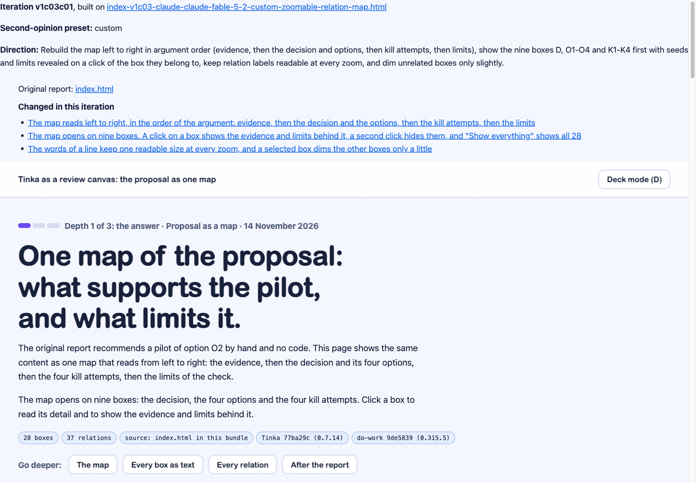
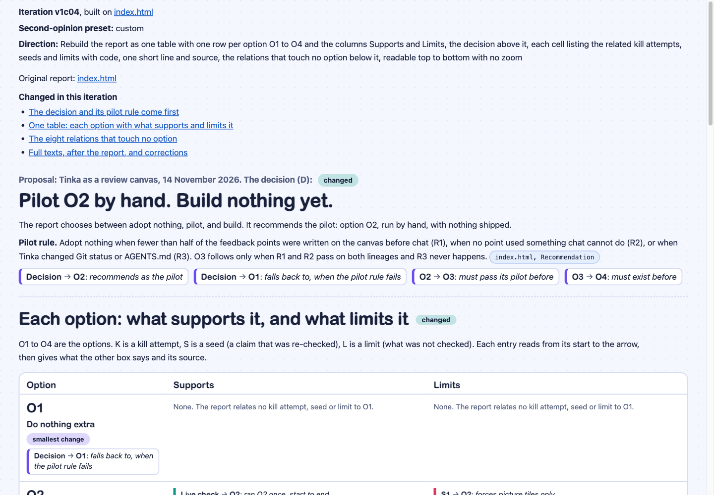
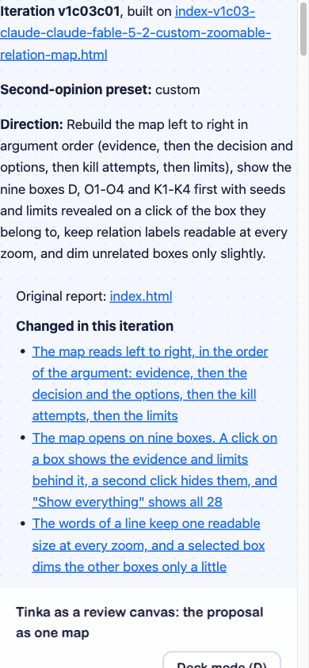
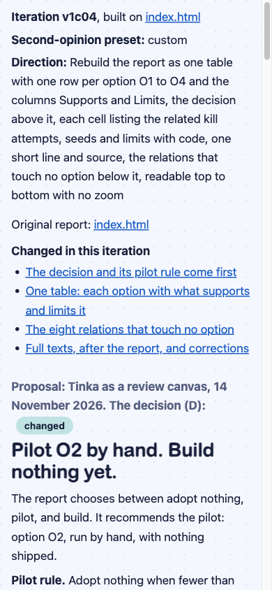

ai-reports/2026-11-14_1547_proposal-tinka-review-surface/index-v1c04-claude-claude-opus-5-5-custom-supports-limits-table.html

# REQ-734 hand-back: the proposal as a supports-and-limits table page, compared with the map page

## Comparison

Both pictures in each table are the first screen at page top, light theme, with no scroll and no click. They were taken from the committed bytes, served from the builder worktree's bundle folder. Both pages open with the same launcher block (iteration id, preset, direction) and a "Changed in this iteration" list.

**Width 1440 × 1000**

| Map: `ai-reports/2026-11-14_1547_proposal-tinka-review-surface/index-v1c03c01-claude-claude-opus-5-5-custom-left-to-right-map.html` | Table: `ai-reports/2026-11-14_1547_proposal-tinka-review-surface/index-v1c04-claude-claude-opus-5-5-custom-supports-limits-table.html` |
|---|---|
|  |  |

- Map: 0 of 37 relations readable on the first screen without a click.
- Table: 4 of 37 relations readable on the first screen without a click (r01 to r04, the order of the options in the decision block).

**Width 390 × 844 (phone)**

| Map: `ai-reports/2026-11-14_1547_proposal-tinka-review-surface/index-v1c03c01-claude-claude-opus-5-5-custom-left-to-right-map.html` | Table: `ai-reports/2026-11-14_1547_proposal-tinka-review-surface/index-v1c04-claude-claude-opus-5-5-custom-supports-limits-table.html` |
|---|---|
|  |  |

- Map: 0 of 37 relations readable on the first screen without a click.
- Table: 0 of 37 relations readable on the first screen without a click.

How the count works (D-06): one script, the same for both pages. A relation counts when its words and both end codes (for example `K2` and `O3`, or `Decision` and `O2`) are visible text, fully inside the viewport, not clipped by a scrolling box, at 12 px or more, with opacity above 0.5. On the table page, the words and codes must sit inside one entry that carries the relation's `data-relation` number. The relation words come from the v1c03 `#rev-3` rows.

What the pictures show: on the map page the map itself starts below the first screen at both widths, and its relation words show only after a click on a box (REQ-733 D-10). On the table page the first screen at 1440 reaches the decision and the order of the options; the table starts below it. At 390 the first screen of both pages holds the launcher block, the change list and the start of the first section.

## Commits

- `6d50d565` [REQ-734] supports-and-limits table page v1c04 for the Tinka proposal

## Files

In the branch:
- created `ai-reports/2026-11-14_1547_proposal-tinka-review-surface/index-v1c04-claude-claude-opus-5-5-custom-supports-limits-table.html` (written by me to the staging page, named and published by the launcher; one CSS edit after finalize, see D-12)
- created `ai-reports/2026-11-14_1547_proposal-tinka-review-surface/v1c04-claude-claude-opus-5-5-custom-supports-limits-table-reply.md` (my final reply, named by the launcher)
- modified `ai-reports/2026-11-14_1547_proposal-tinka-review-surface/index.html` (launcher only: one line added to the iteration list)

Run artifacts outside the branch (not staged, not committed):
- created `do-work/runs/work-2026-11-15-012821/REQ-734-compare-map-1440.png`
- created `do-work/runs/work-2026-11-15-012821/REQ-734-compare-table-1440.png`
- created `do-work/runs/work-2026-11-15-012821/REQ-734-compare-map-390.png`
- created `do-work/runs/work-2026-11-15-012821/REQ-734-compare-table-390.png`
- created `do-work/runs/work-2026-11-15-012821/REQ-734-progress.log`, and this hand-back

## Scope changes

None. The three Scope files only.

## Red-green evidence

- RED at base `18bd280a` (worktree clean, before prepare): `REQ-734-probe.sh` exit 1 with `FAIL: expected one index-v1c04-*.html, found 0`, `FAIL: expected one v1c04-*-reply.md, found 0`, `FAIL: bundle holds 15 files, expected 17 (15 at base plus page and reply)`.
- GREEN at tip `6d50d565`: `REQ-734 probe PASS` (also passed before the commit, after finalize).

## Verification

**Finalize row** (`ai-report-second-opinion --finalize`, exit 0, outcome success): state `ran`, judge verdict `pass`, banner_state `inserted`, tree_id `v1c04`, base_page `ai-reports/2026-11-14_1547_proposal-tinka-review-surface/index.html`, model_evidence `session-declared`, page `index-v1c04-claude-claude-opus-5-5-custom-supports-limits-table.html`, reply `v1c04-claude-claude-opus-5-5-custom-supports-limits-table-reply.md`. The brief expected the state word "published"; the launcher's row says `ran`.

**Re-judge after the D-12 edit:** `ai-report-judge ai-reports/2026-11-14_1547_proposal-tinka-review-surface --page index-v1c04-claude-claude-opus-5-5-custom-supports-limits-table.html`, exit 0, verdict `pass`.

**Browser matrix** (one script, every state, Chrome through the Playwright tool, bundle served by `python3 -I -m http.server` on 127.0.0.1). Run on the staging page before finalize (three runs: fixes below) and again on the published page after the D-12 edit. Numbers of the final run on the published page:

| State | Overlaps | Clipped | Broken words | Text < 12 px (min) | break-anywhere styles | Min contrast | Page width | Rows stacked | Scrolled screens, problems | Tab stops, problems |
|---|---|---|---|---|---|---|---|---|---|---|
| 1440 light, first screen | 0 | 0 | 0 | 0 (12.8 px) | 0 | 5.51 | 1425 | n/a (side by side) | | |
| 1440 light, full page | 0 | 0 | 0 | 0 (12.8 px) | 0 | 5.51 | | | 3, 0 | 12, 0 |
| 1440 dark, first screen | 0 | 0 | 0 | 0 (12.8 px) | 0 | 7.18 | 1425 | n/a | | |
| 1440 dark, full page | 0 | 0 | 0 | 0 (12.8 px) | 0 | 7.18 | | | 3, 0 | 12, 0 |
| 390 light, first screen | 0 | 0 | 0 | 0 (13.6 px) | 0 | 5.51 | 375 | 4 of 4 | | |
| 390 light, full page | 0 | 0 | 0 | 0 (12.8 px) | 0 | 5.51 | | 4 of 4 | 9, 0 | 12, 0 |
| 390 dark, first screen | 0 | 0 | 0 | 0 (13.6 px) | 0 | 7.18 | 375 | 4 of 4 | | |
| 390 dark, full page | 0 | 0 | 0 | 0 (12.8 px) | 0 | 7.18 | | 4 of 4 | 9, 0 | 12, 0 |

- Page width is `document.documentElement.scrollWidth` (the viewport minus the 15 px scroll bar): no page overflow at 390.
- "Scrolled screens" re-measures overlap, clipping, broken words and small text on each screen while scrolling to the end.
- At 390 the decision block starts right after the change list (gap 0 px, the decision section is the next block).
- Tab walk, same in all four states: launcher `index.html`, backlink `index.html`, the four change-list links, the five "full texts" links, the v1c03 page link. Each focused element was fully inside the viewport after the browser scrolled to it, with a 3 px solid outline (`--change` color) in light and dark. The decision, the table and the no-option section hold no links, so focus order matches reading order by construction.
- JavaScript off (a new browser context with scripts disabled, 1440 light): `body.innerText` identical, 8133 characters each. The page has no `<script>` element.
- First matrix run, fixed before finalize: link contrast 4.40 in light (the kit's `--proof` blue on white); 1 word broken at a hyphen at 1440 (`ai-report-canvas`) and 9 at 390 (file names in source chips, `--` in a chip). Fixes: link color mixed toward `--ink` (5.51), and every word with a hyphen or slash wrapped in a `white-space: nowrap` span. A long file name in the closing note became a link with short text.
- The published page first showed the launcher's direction block at x = 0 with no side gutter. Fixed by D-12, then the matrix and the judge ran again (numbers above).

**Diff stat** `git diff --stat main...HEAD`: the three Scope files, 185 insertions (page 161, `index.html` 1, reply 23).

**Capture cleanup:** see D-10. `git status --porcelain --untracked-files=all --ignored` in the worktree prints nothing. `/Users/t2/Desktop/e1-experimental-repos/skill-do-work2/.playwright-mcp/` does not exist (my session created it and removed it). No `.*staging*` file is left in the bundle. Both local servers are stopped.

## P-A-U

- PLAN: generate the page from the v1c03 page's own box texts and relation rows with a scratch Python script, so all 37 relations keep their words and their r01-r37 numbers; place them by D-03; measure every state in a browser before finalize.
- APPLY: prepare in the worktree, write the staging page and reply, three matrix runs to clean, finalize (judge pass), one gutter fix, matrix and re-judge pass, commit by exact path, comparison pictures and counts.
- UNIFY: `git diff --stat main...HEAD` lists only the v1c04 page, the v1c04 reply and `index.html` (+1 line); the probe pins every other bundle file's bytes and passes.

## Decisions

- **D-09 (DECIDE & STATE): each entry reads "From → To: relation words", then "Code: box title" and one source chip.** The brief asks for the other end's code, the words and the source. Many relation words need their target to make sense ("K2 → O3: is not answered by"), and a bare code tells a reader nothing, so the entry also names the other box by its v1c03 title. The source chip is the first chip of that box's `#rev-2` text; the full chip lists stay in the v1c03 page and in `index.html`.
- **D-10 (DECIDE & STATE): captures.** Every working capture went to `/private/tmp/claude-501/-Users-t2-Desktop-e1-experimental-repos-skill-do-work2/7ebdb4e0-bf88-4ef2-9c8a-adace1fd2dd4/scratchpad/build-REQ-734/shots/` (written by `page.screenshot` with absolute paths) and was deleted with `rm -rf .../build-REQ-734/shots`. The Playwright tool wrote one console log to the main tree's `.playwright-mcp/`, a folder that did not exist before my session; I deleted it with `rm -f .playwright-mcp/console-2026-11-15T01-14-03-389Z.log` and `rmdir .playwright-mcp`. The four comparison pictures are the only captures kept.
- **D-11 (DECIDE & STATE): order relations.** The decision block shows r01 to r04. Each option row's header repeats the order relations that touch it: O1 gets r02, O2 gets r01 and r03, O3 gets r03 and r04, O4 gets r04. Repeats carry the same number (D-04). O1 has no supports or limits in the report, so both its cells say "None" instead of an empty cell.
- **D-12 (DECIDE & STATE): one CSS edit after finalize.** The launcher's direction block (`<aside>` after `<body>`) had no side gutter on this page. I added `body > aside { padding: 10px clamp(16px, 2.6vw, 60px) 0; }` and `body > aside p { margin: 0 0 .3em; }` to the page's own `<style>`, then re-judged with `ai-report-judge --page` (pass) and re-ran the matrix (clean). Next time the page's CSS should style `body > aside` before finalize.
- **D-13 (DECIDE & STATE): no `presentation.js`.** The page links `presentation.css` only. It needs no behavior, so it has no script at all and reads the same with JavaScript off.
- **D-14 (DECIDE & STATE): a short closing section with the three corrections and the 0.316.0 / 0.317.0 note.** The clarity-editor prompt asks for corrections. I re-checked each one: `screenshots/` holds 4 files; `ai-report.md:87` describes the visible direction block; `grep -c -i tinka ai-reports/catalog.json` prints 0; `CHANGELOG.md` entries 0.316.0 and 0.317.0 say what the note says.
- **D-15 (DECIDE & STATE): how relations are counted on the map page.** The same generic rule as on the table page (words plus both end codes visible as text in the viewport). The map shows its line words only after a click, so its first-screen count is 0 at both widths by design, not because of a defect found here.

## Discovered Tasks

- The standalone re-judge (`ai-report-judge --page`) left its capture folder `/var/folders/2w/kw8sv6rd1z15yjykl787ryph0000gn/T/ai-report-judge-2024092196/` (judge.json and four PNGs). The command reports it as a created output, so this may be by design. I did not delete it, because it is outside my scratch folder. The finalize judge's own folder is gone.
- The launcher's `<aside>` direction block carries no side padding, so every tree page that does not style `body > aside` shows it flush at x = 0 (the v1c03c01 map page has the same look). A gutter in the launcher's inserted block would fix it for every page.

## Integration seams

- The only shared file is the bundle's `index.html`. The launcher added exactly one line inside the iteration list: new line 32, `<li style="margin-left:0em"><a href="index-v1c04-claude-claude-opus-5-5-custom-supports-limits-table.html">v1c04</a> · custom · claude claude-opus-5-5 · 2026-11-15</li>`, after the v1c03c01 line (31) and before `</ul></nav>`. The markers stay at their base lines. The probe confirms that `index.html` outside the marker block is byte-identical to base.
- No sibling REQ in this run edits the Tinka bundle.

## Proposed CHANGELOG entry

none (no shipped file changes): `.gitattributes:48` export-ignores `/ai-reports`.

## Proposed lesson

- Run the browser check on the published page too, not only on the staging page: finalize inserts the launcher's direction block after `<body>`, and that block changes the first screen (here it had no side gutter and moved the table down by about 160 px).

## Lessons read

- `skills/do-work/tools/do-work-cli/lessons-do-work-cli.md:17` `[family: session-is-the-backend]`: both `staging_page` and `staging_reply` were written before `--finalize`.
- `do-work/archive/UR-177/REQ-733-rebuild-relation-map-page.md` § Lessons Learned (`:292`): measure every state with one script on the first pass; check "no word broken" and phone width before committing.
- `do-work/runs/work-2026-11-15-012821/REQ-733-handback.md`: the measuring approach and D-10 (labels show only for the selected box).
